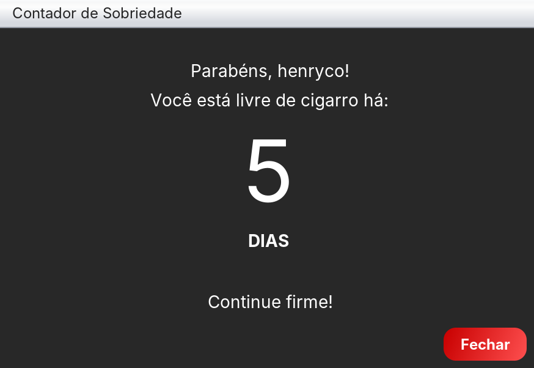
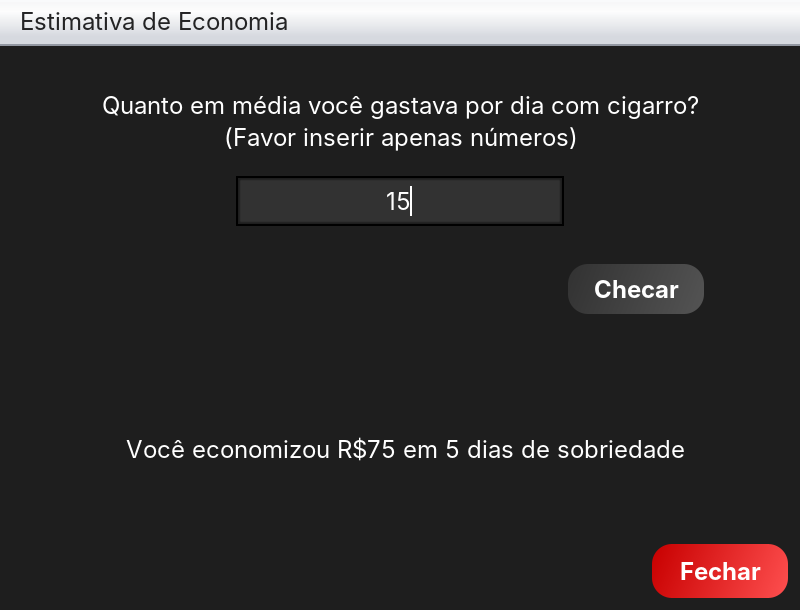
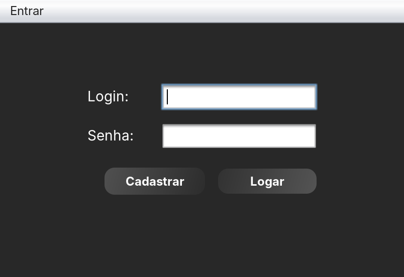

<p align="center">
  
</p>

<p align="center">
  Um novo caminho para a mudança de vida: app para desktop que ajuda quem está largando um vício a acompanhar o próprio progresso.
</p>

<p align="center">
  
  
  
  
</p>

---

## Telas

| Tela principal | Contador de dias |
|:---:|:---:|
|  |  |
| **Estimativa de economia** | **Login** |
|  |  |

<sub>Telas com dados de exemplo.</sub>

## O que ele faz

- **Contador de dias** sem o vício, com marcos especiais de 1 semana, 1 mês e 1 ano
- **Registro de humor** diário, numa escala de 0 a 10, com histórico da última semana, mês ou ano
- **Estimativa de economia:** mostra quanto dinheiro a pessoa já deixou de gastar
- **Notas pessoais** para escrever, editar e apagar
- **Registro de recaída**, que recomeça a contagem
- Cadastro e login de usuários, com uma tela de administração

## Como rodar

**Requisitos:** Java 18 ou mais novo, MySQL rodando e Apache NetBeans 24 (ou compatível). O conector do MySQL já está na pasta `lib/`.

1. Clone o repositório:
   ```bash
   git clone https://github.com/henryco-meneghetti/NewPath.git
   ```
2. No NetBeans, abra o projeto em **File > Open Project**.
3. Em `src/bd/ConexaoBD.java`, coloque o usuário e a senha do seu MySQL:
   ```java
   private static String USERNAME = "seu_usuario_mysql";
   private static String PASSWORD = "sua_senha_mysql";
   ```
4. Clique em **Run**. O banco `newpath` e as tabelas são criados sozinhos na primeira execução.

Para testar, entre com o administrador padrão: login `admin`, senha `1234`. Dá para trocar essas credenciais em `src/telas/TelaLogin.java`.

<details>
<summary>Se o NetBeans reclamar da biblioteca do MySQL</summary>

1. Vá em **Propriedades do Projeto > Bibliotecas**.
2. Remova a biblioteca quebrada, se aparecer.
3. Clique em **Adicionar JAR/Pasta** e escolha `lib/mysql-connector-j-9.3.0.jar`.

</details>

## Como o código está organizado

```
src/
├── bd/       conexão com o MySQL e criação do banco
├── dao/      leitura e gravação no banco (usuários, contador, humor e notas)
├── modelo/   classes com os dados de cada parte do app
├── telas/    interface feita com Swing
└── img/      logo e ícones dos marcos
```

## Limitações conhecidas

- As senhas ficam salvas no banco sem criptografia.
- O login do administrador está fixo no código, então serve só para testes locais.

## Autor

Feito por [Henryco Meneghetti de Queiróz](https://www.linkedin.com/in/henryco-meneghetti-1659b035b/).
